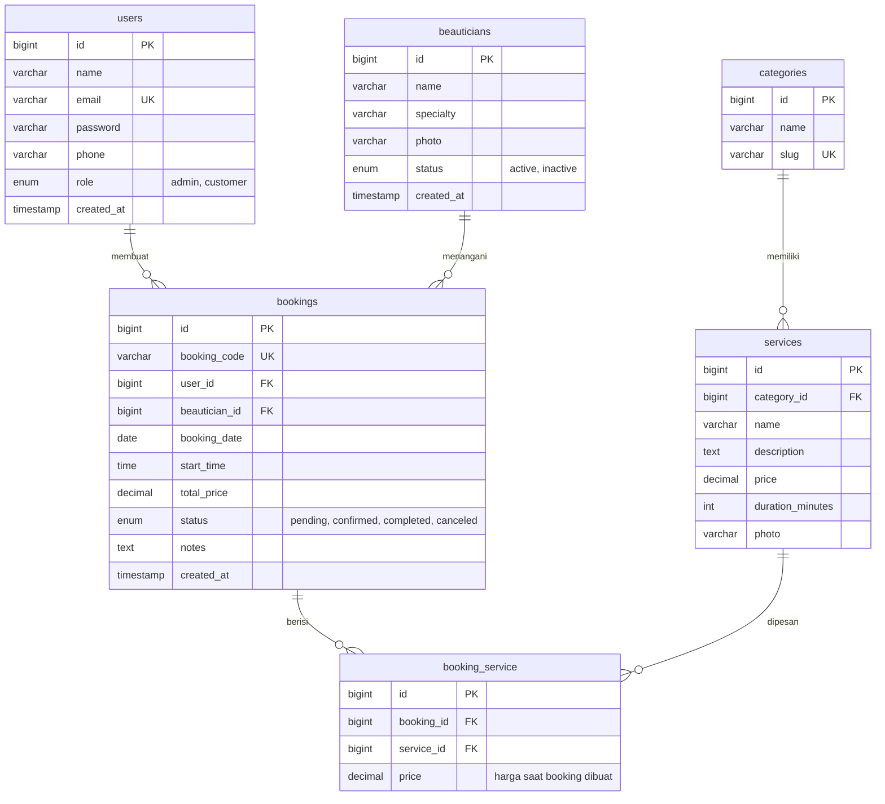

# ERD Laravel5D - Beauty Booking System

Layanan NailArt & LashExtension. Nadiya Syafa - 2410010577 - TI 5D REG BJB

Keterangan: PK = primary key, FK = foreign key, UK = unique.
Relasi `bookings` dan `services` bersifat many-to-many melalui tabel `booking_service`.
