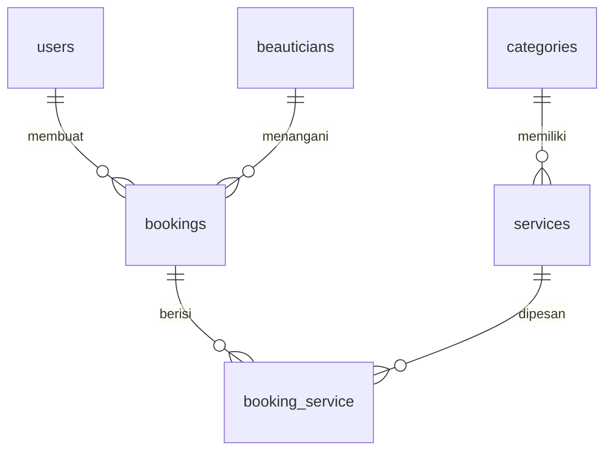

# Progress Report: P01 Database Design

| | |
|---|---|
| **Assignment** | Assignment 1: Table Relationships: NailArt & LashExtension |
| **Student** | Nadiya Syafa |
| **NPM** | 2410010577 |
| **Class** | TI 5D REG BJB |
| **Phase** | P01: Database Design |
| **Branch** | `feature/p01-database-design` |
| **Tanggal** | 1 November 2026 |
| **Status** | Done |

## 1. Ringkasan
Pada fase ini saya merancang dan membuat struktur database untuk aplikasi booking layanan kecantikan (NailArt & LashExtension) berbasis Laravel. Hasilnya berupa ERD, 6 tabel beserta relasinya, model Eloquent, dan seeder awal untuk kategori layanan.

## 2. Daftar Pekerjaan
| Job | Deskripsi | Output | Status |
|---|---|---|---|
| J1 | Merancang ERD | `docs/erd.jpg` | Done |
| J2 | Membuat migration 6 tabel | `database/migrations/` | Done |
| J3 | Mendefinisikan relasi antar tabel (foreign key) | migration `services`, `bookings`, `booking_service` | Done |
| J4 | Membuat model Eloquent dan relasinya | `app/Models/` | Done |
| J5 | Membuat seeder kategori (Nail Art, Lash Extension) | `database/seeders/` | Done |
| J6 | Dokumentasi README dan progress report | `README.md`, `docs/progress/` | Done |

## 3. Struktur Tabel
| Tabel | Tipe | Keterangan |
|---|---|---|
| `users` | Master | Akun admin dan customer (ditambah kolom `phone` dan `role`) |
| `beauticians` | Master | Data beautician dan statusnya |
| `categories` | Master | Kategori layanan (Nail Art, Lash Extension) |
| `services` | Master | Layanan beserta harga dan durasi |
| `bookings` | Transaksi | Data pemesanan |
| `booking_service` | Pivot | Layanan yang dipesan pada tiap booking |

## 4. Relasi Antar Tabel


| Relasi | Jenis | Implementasi |
|---|---|---|
| `users` - `bookings` | 1-N | `bookings.user_id` |
| `beauticians` - `bookings` | 1-N | `bookings.beautician_id` |
| `categories` - `services` | 1-N | `services.category_id` |
| `bookings` - `services` | N-N | pivot `booking_service` |

## 5. Keputusan Desain
- **Harga di pivot (`booking_service.price`)**: menyimpan harga saat booking dibuat, sehingga riwayat transaksi tidak berubah ketika harga layanan diperbarui.
- **Enum status**: `role` (`admin`, `customer`), status beautician (`active`, `inactive`), dan status booking (`pending`, `confirmed`, `completed`, `canceled`) agar nilai terkontrol.
- **Kolom unik**: `users.email`, `categories.slug`, dan `bookings.booking_code`.
- **Aturan hapus (`onDelete`)**: beautician dan layanan yang sudah dipakai di booking tidak bisa dihapus (`restrict`) supaya riwayat transaksi aman. Hapus user, booking, atau kategori ikut menghapus data turunannya (`cascade`).
- **Timestamp**: tabel `beauticians` dan `bookings` hanya memakai `created_at` sesuai ERD (`UPDATED_AT = null` pada model). Tabel `categories` dan `services` tidak memakai timestamp.
- **Tabel `users`**: memakai tabel bawaan Laravel, lalu ditambah `phone` dan `role` lewat migration terpisah.

## 6. Cara Verifikasi
```bash
php artisan migrate:fresh --seed
php artisan migrate:status
php artisan db:show --counts
php artisan db:table bookings
php artisan tinker --execute="dump(App\Models\Category::pluck('name'));"
```
Hasil yang diharapkan:
- Semua migration berstatus `Ran`.
- Keenam tabel terbentuk dengan foreign key sesuai ERD.
- Tabel `categories` berisi `Nail Art` dan `Lash Extension`.

## 7. Kendala
- (isi jika ada kendala selama pengerjaan, atau tulis "Tidak ada")

## 8. Belum Dikerjakan
- Seeder untuk `users`, `beauticians`, dan `services`.
- Autentikasi, CRUD, dan halaman antarmuka.
- Logika booking (validasi jadwal bentrok dan perhitungan `total_price`).
